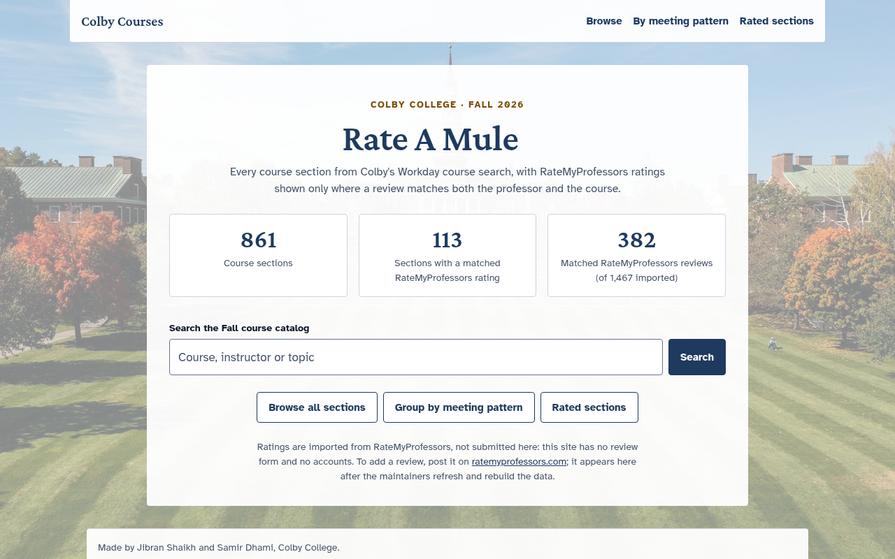
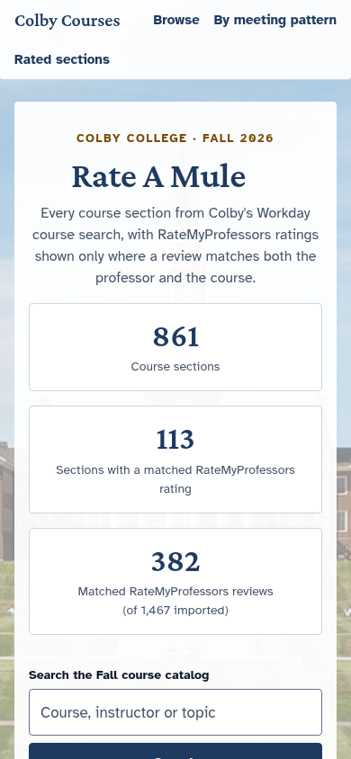

# Colby Courses (Rate A Mule)

A searchable browser for Colby College Fall 2026 course sections, in the spirit of [Layup List](https://github.com/layuplist/layup-list).
One static page (`index.html`) over JSON data files; no build step.

- Live site: https://rateamule.me/
- Repository: https://github.com/jibranshaikh0/colby-courses



*Desktop landing view (historical snapshot: main `ef61adb`, 2026-11-08, before the search/footer update `080ee02` added Humza Sehbai to the footer).*



*Mobile landing view (historical snapshot: main `ef61adb`, 2026-11-08, before the search/footer update `080ee02` added Humza Sehbai to the footer).*

## Functionality

- **Landing view** (the default): three stats, a catalog search box, and links into the catalog
  (all sections, grouped by meeting pattern, rated sections). The stats show 861 course sections,
  113 sections with a matched RateMyProfessors rating, and 382 matched reviews (of 1,467 imported).
  Section and rating counts are computed from the loaded data at runtime; the 1,467 imported-review
  total is fixed in the page. If the ratings file fails to load, the rating stats show as unavailable rather than 0.
- **Catalog browsing** with these controls:
  - search over codes, titles, instructors, descriptions and departments;
  - Subject dropdown, labelled `CODE: Name` (name provenance is in `subject-names.md`);
  - Course tag dropdown;
  - Meeting-pattern dropdown (exact match, see below);
  - "Open sections only" and "Rated sections only" toggles;
  - grouping: catalog order, or grouped by meeting pattern.
- **RateMyProfessors ratings per section**, shown only when a review matches both the section's
  professor and its course. There are no career-wide averages or cross-professor pooling.
- **Ratings are imported, not submitted.** The site has no accounts and no review form; reviews are
  added on ratemyprofessors.com and appear after the maintainers refresh and rebuild the data.

## Usage

Run it locally:

```sh
python3 -m http.server 8080   # then open http://localhost:8080
```

Start from the landing page's search box or its links into the catalog. In the catalog, filter by
subject, course tag and meeting pattern, show only open or only rated sections, group sections by
meeting pattern, or search codes, titles, instructors, descriptions and departments. Course codes work
with or without a space and in any case (`CS 151`, `cs151` and `CS151` all find the same sections);
add a section letter (`cs151a`) or a lab (`cs231l`) to narrow them. Everything else about search is
unchanged.

The meeting-pattern filter matches a section's full weekly pattern exactly. `MWF` lists sections
that meet on Monday, Wednesday and Friday and on no other day. A section with several meetings has
its own combined pattern (a `MWF` lecture with an `R` lab is `MWF + R`), which is never merged into a
single day set. Sections without a listed time are under "No meeting time listed". There is no
"meets on a given day" filter: by design, the exact pattern filter replaced it.

## Data

`data/courses-fall2026.json` holds every Fall 2026 section from Workday's
**Find Course Sections for Registration** report (861 sections).
`data/rmp-course-ratings-fall2026.json` holds the RateMyProfessors ratings, matched per professor
and per course; `data/RMP-ENRICHMENT-README.md` explains how it is built and refreshed
(`python3 data/build_rmp_enrichment.py` rebuilds it offline from the bundled raw inputs;
`python3 data/test_rmp_matching.py` tests the matching rules). `data/RMP-COVERAGE-DELTA.md`
documents the change from 110 to 113 rated sections.

To refresh it or add a term (needs a Colby Workday login):

1. Run the report in Workday for the term you want.
2. In the browser's network tab, find the request
   `/colby/faceted-search2/<page-id>/fs0/pagination/<offset>.htmld` and note `<page-id>`.
3. From the browser console on that page, fetch every offset (0, 50, 100, …) and save the list of responses as `raw-<term>.json`.
4. `python3 parse_workday.py raw-<term>.json data/courses-<term>.json`

Raw responses include the logged-in user's name and ID, so `raw-*.json` is git-ignored. Only the parsed file is committed.

## Commit history

The history is linear, with 30 commits as of `main` ef61adb (2026-11-08).
See [docs/commit-graph.svg](docs/commit-graph.svg).

## Makers

Jibran Shaikh and Samir Dhami, Colby College.
With humble thanks to [Repose](https://repose.herakraft.co), Colby Hacker, and [Claude](https://claude.ai).

## License

MIT
